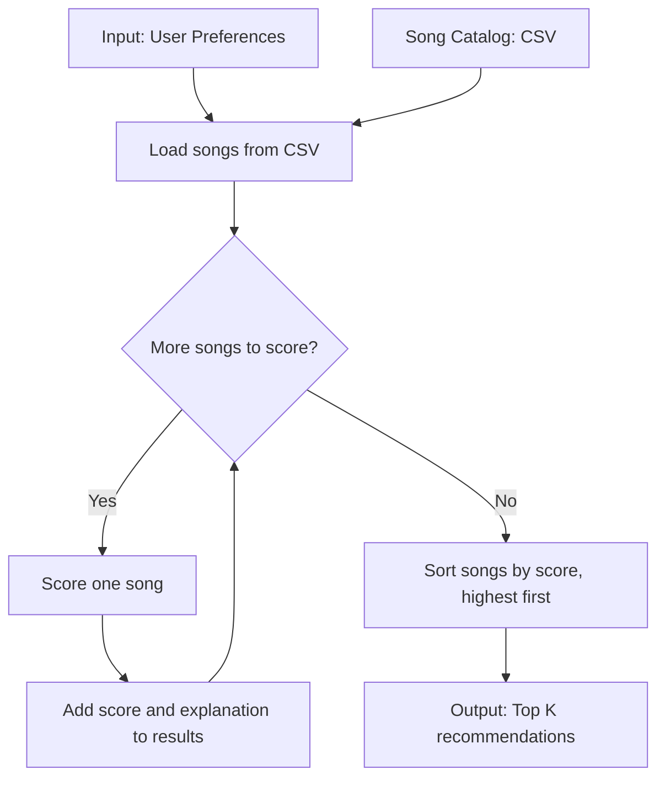

# 🎵 Music Recommender Simulation

## Project Summary

In this project you will build and explain a small music recommender system.

Your goal is to:

- Represent songs and a user "taste profile" as data
- Design a scoring rule that turns that data into recommendations
- Evaluate what your system gets right and wrong
- Reflect on how this mirrors real world AI recommenders

Replace this paragraph with your own summary of what your version does.

---

## How The System Works

My plan is to read the user's preferences and the songs from the CSV file. Then the program checks each song, gives it points for matching the preferences, and sorts the songs by score. It returns the top K songs as recommendations.

My finalized Algorithm Recipe is:

- **+2.0 points** if the genre matches.
- **+1.0 point** if the mood matches.
- **Up to +1.0 point** for energy. The closer the song's energy is to the user's target, the more points it gets.
- **Optional +0.5 point** if the song's acousticness matches the user's acoustic preference. A song with acousticness of 0.5 or higher counts as acoustic.

The program adds the points together and recommends the songs with the highest scores. Genre is worth more than mood, so the system might over-prioritize genre and miss a great song that matches the user's mood instead. The catalog is also small, so it may not include enough music to fit everyone's taste.

The `Song` object will use these features:

- `id`, `title`, and `artist`
- `genre` and `mood`
- `energy`, `tempo_bpm`, `valence`, `danceability`, and `acousticness`

The `UserProfile` object will store:

- `favorite_genre`
- `favorite_mood`
- `target_energy`
- `likes_acoustic`



For the simulation, my default taste profile is `{"genre": "pop", "mood": "happy", "energy": 0.8}`. The profile is simple and limited: it favors songs close to these preferences and does not represent every kind of listener.

---

## Getting Started

### Setup

1. Create a virtual environment (optional but recommended):

   ```bash
   python -m venv .venv
   source .venv/bin/activate      # Mac or Linux
   .venv\Scripts\activate         # Windows

2. Install dependencies

```bash
pip install -r requirements.txt
```

3. Run the app:

```bash
python -m src.main
```

### Running Tests

Run the starter tests with:

```bash
pytest
```

You can add more tests in `tests/test_recommender.py`.

---

## Sample Recommendation Output

Here is the output from running `python -m src.main`:

```
Loaded songs: 18

Top recommendations (genre=pop, mood=happy, energy=0.8):
1. Sunrise City - Score: 3.98
   Reasons: genre match (+2.0); mood match (+1.0); energy similarity (+0.98)
2. Gym Hero - Score: 2.87
   Reasons: genre match (+2.0); energy similarity (+0.87)
3. Rooftop Lights - Score: 1.96
   Reasons: mood match (+1.0); energy similarity (+0.96)
4. Sunday Market - Score: 0.96
   Reasons: energy similarity (+0.96)
5. Night Drive Loop - Score: 0.95
   Reasons: energy similarity (+0.95)
```

**Screenshot or video** *(optional)*: <!-- Insert a screenshot or demo video link here -->

---

## Experiments You Tried

Use this section to document the experiments you ran. For example:

- What happened when you changed the weight on genre from 2.0 to 0.5
- What happened when you added tempo or valence to the score
- How did your system behave for different types of users

---

## Limitations and Risks

Summarize some limitations of your recommender.

Examples:

- It only works on a tiny catalog
- It does not understand lyrics or language
- It might over favor one genre or mood

You will go deeper on this in your model card.

---

## Reflection

Read and complete `model_card.md`:

[**Model Card**](model_card.md)

Write 1 to 2 paragraphs here about what you learned:

- about how recommenders turn data into predictions
- about where bias or unfairness could show up in systems like this
