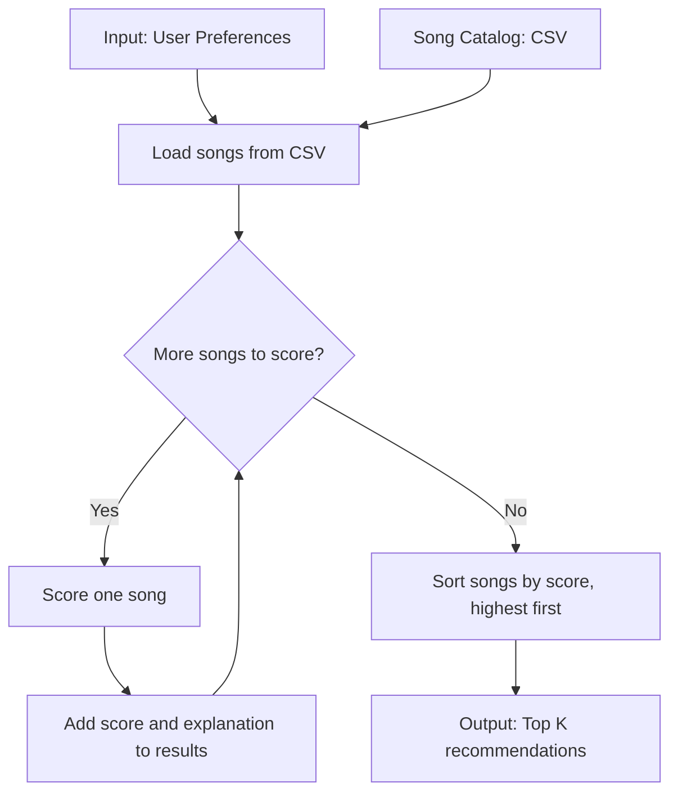

# 🎵 Music Recommender Simulation

## Project Summary

In this project you will build and explain a small music recommender system.

Your goal is to:

- Represent songs and a user "taste profile" as data
- Design a scoring rule that turns that data into recommendations
- Evaluate what your system gets right and wrong
- Reflect on how this mirrors real world AI recommenders

Replace this paragraph with your own summary of what your version does.

---

## How The System Works

My plan is to read the user's preferences and the songs from the CSV file. Then the program checks each song, gives it points for matching the preferences, and sorts the songs by score. It returns the top K songs as recommendations.

My finalized Algorithm Recipe is:

- **+1.0 point** if the genre matches.
- **+1.0 point** if the mood matches.
- **Up to +2.0 points** for energy. The closer the song's energy is to the user's target, the more points it gets.
- **Optional +0.5 point** if the song's acousticness matches the user's acoustic preference. A song with acousticness of 0.5 or higher counts as acoustic.

The program adds the points together and recommends the songs with the highest scores. This experiment gives energy twice as much weight as before and cuts the genre weight in half. The catalog is small, so it may not include enough music to fit everyone's taste.

The `Song` object will use these features:

- `id`, `title`, and `artist`
- `genre` and `mood`
- `energy`, `tempo_bpm`, `valence`, `danceability`, and `acousticness`

The `UserProfile` object will store:

- `favorite_genre`
- `favorite_mood`
- `target_energy`
- `likes_acoustic`



For the simulation, my default taste profile is `{"genre": "pop", "mood": "happy", "energy": 0.8}`. The profile is simple and limited: it favors songs close to these preferences and does not represent every kind of listener.

---

## Getting Started

### Setup

1. Create a virtual environment (optional but recommended):

   ```bash
   python -m venv .venv
   source .venv/bin/activate      # Mac or Linux
   .venv\Scripts\activate         # Windows

2. Install dependencies

```bash
pip install -r requirements.txt
```

3. Run the app:

```bash
python -m src.main
```

### Running Tests

Run the starter tests with:

```bash
pytest
```

You can add more tests in `tests/test_recommender.py`.

---

## Sample Recommendation Output

Here is the output from running `python -m src.main` with three different profiles and one conflicting edge case, using the experimental weights:

```
Loaded songs: 18

High-Energy Pop (genre=pop, mood=happy, energy=0.95):
1. Sunrise City - Score: 3.74
   Reasons: genre match (+1.0); mood match (+1.0); energy similarity (+1.74)
2. Gym Hero - Score: 2.96
   Reasons: genre match (+1.0); energy similarity (+1.96)
3. Rooftop Lights - Score: 2.62
   Reasons: mood match (+1.0); energy similarity (+1.62)
4. Heavy Weather - Score: 1.98
   Reasons: energy similarity (+1.98)
5. Storm Runner - Score: 1.92
   Reasons: energy similarity (+1.92)

Chill Lofi (genre=lofi, mood=chill, energy=0.40):
1. Midnight Coding - Score: 3.96
   Reasons: genre match (+1.0); mood match (+1.0); energy similarity (+1.96)
2. Library Rain - Score: 3.90
   Reasons: genre match (+1.0); mood match (+1.0); energy similarity (+1.90)
3. Focus Flow - Score: 3.00
   Reasons: genre match (+1.0); energy similarity (+2.00)
4. Spacewalk Thoughts - Score: 2.76
   Reasons: mood match (+1.0); energy similarity (+1.76)
5. Coffee Shop Stories - Score: 1.94
   Reasons: energy similarity (+1.94)

Deep Intense Rock (genre=rock, mood=intense, energy=0.90):
1. Storm Runner - Score: 3.98
   Reasons: genre match (+1.0); mood match (+1.0); energy similarity (+1.98)
2. Gym Hero - Score: 2.94
   Reasons: mood match (+1.0); energy similarity (+1.94)
3. Heavy Weather - Score: 1.88
   Reasons: energy similarity (+1.88)
4. Sunday Market - Score: 1.88
   Reasons: energy similarity (+1.88)
5. Sunrise City - Score: 1.84
   Reasons: energy similarity (+1.84)

Edge Case - Conflicting Metal (genre=metal, mood=chill, energy=0.10):
1. Spacewalk Thoughts - Score: 2.64
   Reasons: mood match (+1.0); energy similarity (+1.64)
2. Library Rain - Score: 2.50
   Reasons: mood match (+1.0); energy similarity (+1.50)
3. Midnight Coding - Score: 2.36
   Reasons: mood match (+1.0); energy similarity (+1.36)
4. Quiet Pines - Score: 1.56
   Reasons: energy similarity (+1.56)
5. Coffee Shop Stories - Score: 1.46
   Reasons: energy similarity (+1.46)
```

**Screenshot or video** *(optional)*: <!-- Insert a screenshot or demo video link here -->

---

## Experiments You Tried

The results mostly feel right to me: Midnight Coding and Library Rain lead for the chill lofi listener, and Storm Runner leads for the intense rock listener. With the new weights, Sunrise City ranks first for High-Energy Pop because it matches both genre (+1.0) and mood (+1.0), then earns +1.74 for its energy being close to 0.95.

The weight shift changed the edge-case ranking: Spacewalk Thoughts now comes first because its chill mood and low energy score higher together than Heavy Weather's metal genre match. That seems more accurate for this particular conflicting profile, but it is only a small example and doesn't prove the recommendations are generally more accurate. It is definitely different: energy has more influence now, so songs with a close energy can rank higher even when their genre does not match. The same songs can also appear in multiple lists because the system does not enforce variety.

---

## Limitations and Risks

Summarize some limitations of your recommender.

Examples:

- It only works on a tiny catalog
- It does not understand lyrics or language
- It might over favor one genre or mood

You will go deeper on this in your model card.

---

## Reflection

Read and complete `model_card.md`:

[**Model Card**](model_card.md)

Write 1 to 2 paragraphs here about what you learned:

- about how recommenders turn data into predictions
- about where bias or unfairness could show up in systems like this
